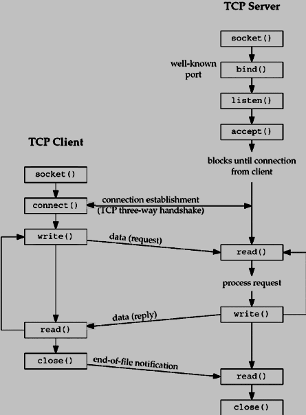

> *This file gives much wider information on the rules and concepts provided by the subject*

- ssize_t recv(size_t size; 
                        int sockfd, void buf[size], size_t size,
                        int flags); 
    
    :used to receive messages from a socket. They may be used to receive data on both **connectionless and connection-oriented sockets**. The only difference between recv() and read(2) is hte presence of **flags**.

    Return Type - the size of the message on successful completion. 
    1. If a message is too long to fir in the supplied buffer, excess bytes might be discarded depending on the type of the socket the message is received from. 
    2. If no messages are avaibable at the socket, the receive calls wait for a message to arrive if socket is blocking.

    An application can use select(2), poll(2), or epoll(7) to
       determine when more data arrives on a socket.

- int fcntl(int fd, int op, ...); -- fcntl(fd, F_SETFL, O_NONBLOCK);

    -: int fcntl(int fd, F_SETFL, int arg);
    F_SETFL - operation argument. Sets the file status flags to the values specified by **arg** argument. 
    Each open file description has certain associated status flags, initialised by open(2) and possibly modified by fcntl(2). 

    -: O_NONBLOCK - 

- int poll(struct pollfd *fds, nfds_t nfds, int timeout);

    -: waits for one of a set of file descriptors to become ready to perform I/O operations. 

    The set of file descriptors to be monitored is specified in the **fds** argument, which is an array of structures of the following form - 

        struct pollfd {
            int   fd;         /* file descriptor */
            short events;     /* requested events */
            short revents;    /* returned events */
        };
    
- int socket(int domain, int type, int protocol); -- socket(..., SOCK_STREAM, ...)

    -: create an endpoint for communication and returns a file descriptor that refers to that endpoint. 

    type(Communication semantics) - SOCK_STREAM (Connection-oriented socket, TCP/IP) - Provides sequenced, reliable, two-way, connection based byte streams. 

    tcp_socket = socket(AF_INET, SOCK_STREAM, 0); - ip - Linux IPv4 protocol implementation. IPPROTO_TCP - correct IP protocol to be used

- int bind(int sockfd, const struct sockaddr *addr,
                socklen_t addrlen);

    Note that the address and the port are always stored in network
       byte order.  In particular, this means that you need to call
       **htons(3)** on the number that is assigned to a port.  All
       address/port manipulation functions in the standard library work
       in network byte order. host to network (ntons, htonl)

- int listen(int sockfd, int backlog);

    -: The **sockfd** argument is a file descriptor that refers to a socket
       of type SOCK_STREAM or SOCK_SEQPACKET.
    
    -: The **backlog** argument defines the maximum length to which the queue
       of pending connections for sockfd may grow.

        To accept connections, the following steps are performed:

           (1)  A socket is created with socket(2).

           (2)  The socket is bound to a local address using bind(2), so
                that other sockets may be connect(2)ed to it.

           (3)  A willingness to accept incoming connections and a queue
                limit for incoming connections are specified with
                listen().

           (4)  Connections are accepted with accept(2).

- int setsockopt(int socket, int level, int option_name,
            const void *option_value, socklen_t option_len);

    -: sets the socket options. 

### Connectionless Socket. VS. Connection-oriented Socket.
These two types define how data is transmited between a client and a server and differ mainly in 

**A connection-oriented service** establishes a dedicated communication path between the sender and receiver before any data is transferred. This process involves a handshake to set up the connection, ensuring both parties are ready for communication. **Once** the connection is established, data packets are transmitted in a sequence and reliable way. - TCP

## Blocking and Non-Blocking File Descriptors Under the Hood
Blocking are sleeping while waiting for something(forget) to be ready. Will write later. 

[Possible an IRC Client that might be used with our server ](https://www.rfc-editor.org/info/rfc2812/#section-3)

