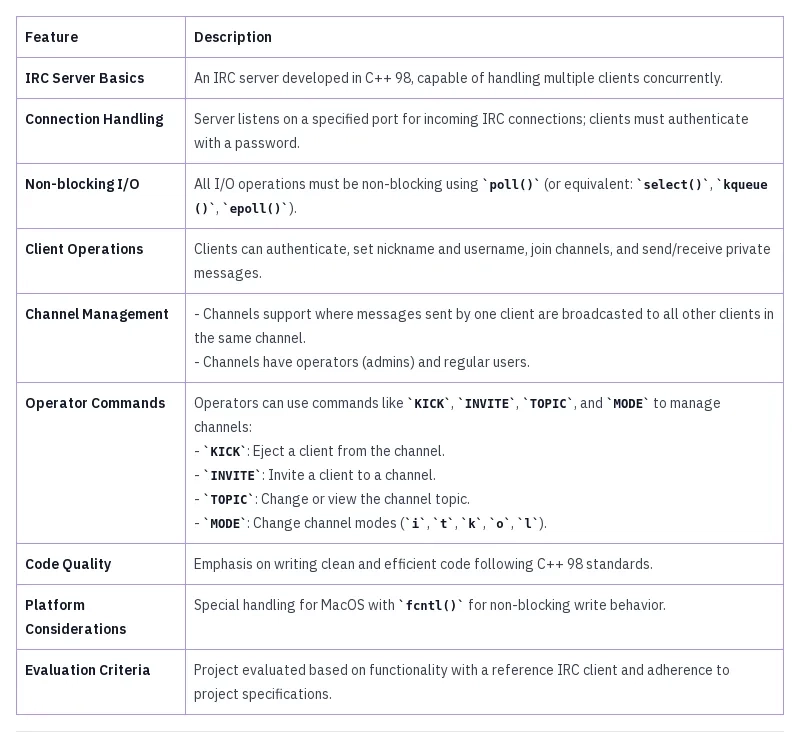
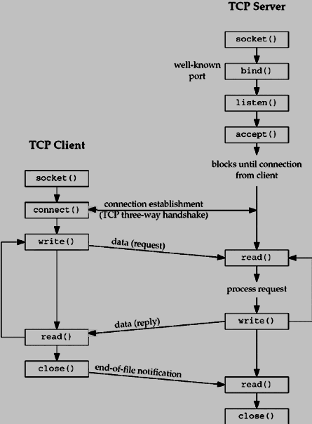

> *This project has been created as part of the 42 curriculum by matnusko, nkuydin.*

## Description

[Client Side IRSSI](https://github.com/irssi/irssi)

## Instructions

## Resources
[Explanation of Core Socket Functions](https://www.tutorialspoint.com/unix_sockets/socket_core_functions.htm)